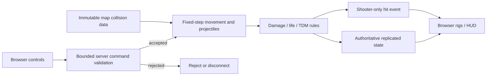

# Phase 1: Two-Client Authoritative TDM — Research

**Researched:** 2026-10-03
**Domain:** Authoritative browser FPS, shared simulation, dedicated HTTP/WSS hosting
**Confidence:** MEDIUM overall; package/TLS probes passed, gameplay integration remains untested.

<user_constraints>
## User Constraints (from CONTEXT.md)

The following decisions are copied verbatim from the phase context. [VERIFIED: 01-CONTEXT.md, Implementation Decisions]

<!-- DATA_A72D9B31_START -->
### Server entry and hosting
- **D-01:** An admin deploys a specific dedicated server. Players connect to that server; no global matchmaking or server discovery is required.
- **D-02:** One server link serves the browser game and connects it to the same server. The eventual entry flow is server link → lobby list → join or create. Phase 1 may expose just the initial TDM entry; Phase 2 supplies the full lobby browser.
- **D-03:** Preserve the operator command `npm run mp-server -- --port <port> --host <bind-address> --tls --public <advertised-address>`. Document defaults, `--help`, actionable configuration errors, and the distinction between bind and advertised addresses. The advertised address is an address/URL, not a claim of public Internet reachability.
- **D-04:** For now, `--tls` uses a self-signed certificate for testing. Automate generation and reuse to keep setup simple, explain the browser trust step, and keep private keys out of version control. Trusted public certificate issuance/renewal is outside Phase 1.

### TDM defaults and lifecycle
- **D-05:** Default to 50 team kills, a 10-minute match, and a 3-second respawn. End at the score or time limit. Rules remain adjustable; full player-facing lobby configuration is delivered in Phase 2.
- **D-06:** Friendly fire defaults to 25% damage and is adjustable per lobby. Apply the reduction on the server.
- **D-07:** Assign new players to the smaller team. Allow team switching only when it preserves balance; the server validates assignment and switching.
- **D-08:** One human player is enough to start a match; do not require a human on each team. Support solo-human, bot-filled matches once Phase 4 implements bots. Automatic start is the working interpretation of the user's correction to the proposed automatic-start rule; countdown duration is builder discretion.
- **D-09:** Show match results for 15 seconds, then automatically rematch with the same lobby settings. Reset match-owned state cleanly. An empty room should not run an endless series of matches; resume according to the one-human start rule.

### Feedback and errors
- **D-10:** Reuse the existing combat feedback: a crosshair hit marker and feedback at the character hit, visible only to the shooting player. These communicate server-confirmed hits; do not let client assertions create confirmed damage or hit feedback.
- **D-11:** Display client-side connection errors at the top of the screen. Keep messages readable and actionable.

### Builder Discretion
- Select and validate the runtime, transport, headless shared simulation, and collision approach. The prior Node/Colyseus/Rapier proposal is a candidate, not a locked technical decision.
- Choose initial existing map, bounded input/message formats, simulation and snapshot rates, and the minimal validated weapon/action set needed for real TDM. Preserve current art and weapon behavior where feasible; full combat tuning is later.
- Define deterministic tie handling, countdown duration, respawn placement, switch timing, last-player departure behavior, and phase-appropriate disconnect cleanup. Document assumptions and test lifecycle transitions.
- Choose certificate storage, CLI defaults/configuration format, logging, initial nickname handling, and minimal entry/results/error UI details without expanding into accounts or administrative dashboards.
- Do not infer that requested 8/12/16/24 slots or a 60 FPS target have already been benchmarked or qualified.
<!-- DATA_A72D9B31_END -->

### Deferred Ideas (OUT OF SCOPE)

<!-- DATA_E591C032_START -->
- **Phase 2:** Server-local lobby list; players join/create lobbies; adjustable game rules and player limits using the Phase 1 defaults. Support requested capacities only through qualified profiles.
- **Phase 3:** Prepare empty lobbies for each supported game type at server launch as TDM, DM, S&D, CTF, and Hardpoint become available.
- **Phase 4:** Adjustable bot filling in the same lobby/rule model, including a single human playing with bots. Qualify Raspberry Pi capacities through measurement.
- **Later operator work:** Trusted public certificate issuance/renewal if requested; Phase 1 is self-signed testing.
<!-- DATA_E591C032_END -->
</user_constraints>

## Summary

**Recommendation:** Use Node 24, focused Colyseus 0.18 packages, Express static serving, and selfsigned certificate generation. Extract the existing grid simulation into per-match headless functions; defer Rapier adoption. This is a phase-specific engineering recommendation, supported by official APIs and the isolated compatibility probe below, rather than a capacity claim.

The repository already supplies rendering, models, maps, effects and useful scalar math. Its multiplayer seam is a new authoritative room plus browser presentation adapter, not importing the player/enemy rendering graph into Node. Preserve offline behavior through an explicit online branch. Initial online scope should be one existing map, walking/sprinting/jumping/crouching and one validated firearm with reload; disable unsupported online actions visibly. These are recommendations within builder discretion, not new locked product requirements.

## Architectural Responsibility Map

| Capability | Primary tier | Secondary tier | Recommendation |
|---|---|---|---|
| Inputs, eligibility, movement, bullets, damage | Server | Shared kernel | Derive state from intentions |
| Teams, respawns, score, results/rematch | Server room | Browser HUD | Replicate authoritative transitions |
| Cameras, assets, animation, feedback | Browser | Server events | Present state without awarding outcomes |
| Game delivery and TLS | Server HTTP/HTTPS | Browser trust | Same origin for assets and networking |

<phase_requirements>
## Phase Requirements

Requirement descriptions below follow REQUIREMENTS.md. [VERIFIED: .planning/REQUIREMENTS.md, Authoritative Multiplayer / Modes / Hosting]

| ID | Required behavior | Research support |
|---|---|---|
| NET-01 | Two browsers join, see each other and complete existing-map TDM | Room, remote actors, two-context browser tests |
| NET-03 | Server derives movement; rejects invalid/stale/duplicate/impossible requests | Fixed step, bounded commands, epochs, collision |
| NET-04 | Server owns firing, travel, hits, damage, death and score | Swept projectiles, eligibility, private confirmation |
| MODE-01 | Teams, respawns and consistent server-scored winner | Match state machine and lifecycle tests |
| HOST-03 | Specified CLI, TLS, advertised-address semantics, helpful errors | Shared HTTP server and certificate probe |
</phase_requirements>

## Project Constraints (from AGENTS.md)

Follow plain JavaScript ESM, surrounding formatting, two spaces, semicolons, single quotes and minimal unrelated changes. Install application dependencies through the tracked lockfile; use Vite serving/builds. Keep offline modes, prefix-aware asset URLs, tile serialization, live map activation ordering, seconds-versus-milliseconds contracts and simulation-eye camera restoration. Preserve synchronous event ordering and use named handlers for cleanup. Keep template assets alive and dispose owned character resources. Wait for enabled menu controls in browser tests; inspect actual poses when adapting character presentation. Extend lint/typecheck coverage to new authoritative modules because existing `checkJs: false` does not verify JavaScript rules. These are actionable repository instructions, not research assumptions. [VERIFIED: AGENTS.md, Project and tooling / Runtime map / Maps / Validation]

## Standard Stack

| Component | Exact version / policy | Evidence |
|---|---|---|
| Node | 24; probe used 24.19.0 | Local `node --version`; Node lists 24 as LTS. [CITED: https://nodejs.org/en/about/previous-releases] |
| Colyseus core | 0.18.18 | Registry engine `>= 22.x`; isolated import/join/input passed. [CITED: https://registry.npmjs.org/@colyseus/core] |
| SDK / schema / WS transport | 0.18.4 / 5.0.35 / 0.18.4 | Combined isolated install/import passed. [CITED: https://docs.colyseus.io/migrating/0.18] |
| Express | 5.2.1 | Official static middleware, registry legitimacy OK. [VERIFIED: npm registry] [CITED: https://expressjs.com/en/starter/static-files/] |
| selfsigned | 5.5.0 | Registry engine `>=18`, legitimacy OK; async SAN/TLS probe passed. [VERIFIED: npm registry] |
| Existing client/test tooling | Retain tracked versions | Lockfile inspected: Three 0.160.1, Vite 8.0.8, Vitest 4.1.3, Playwright 1.59.1, TypeScript 6.0.2. [VERIFIED: package-lock.json, packages entries] |

Use schema builders rather than adding decorator tooling; builders run in JavaScript. [CITED: https://docs.colyseus.io/state/schema] Pin approved dependencies; do not install the umbrella server/admin/database suite. CI currently declares `node-version: 20`; update it to the chosen server runtime. [VERIFIED: .github/workflows/test.yml:18-21]

### Alternatives Considered

| Alternative | Strongest case | Phase recommendation |
|---|---|---|
| Node + `ws` 8.22.0 | Small transport surface; shares HTTP/HTTPS server | Colyseus avoids owning room admission, replication and subsequent prediction plumbing. [CITED: https://github.com/websockets/ws/blob/master/doc/ws.md] |
| Node + Colyseus + Rapier 0.21.0 | General character/shape queries; WASM probe works | Defer physics conversion: grid parity and explicit world state are the immediate need. Rapier controller handles translation, and determinism requires identical initialization/order. [CITED: https://rapier.rs/docs/user_guides/javascript/character_controller/] [CITED: https://rapier.rs/docs/user_guides/javascript/determinism/] |

## Package Legitimacy Audit

The seam checked registry/source repository/download signals. Recommended Colyseus packages were **SUS solely because their current versions were recently published**, not because installation failed or a security flaw was found. Preserve the workflow gate: planner inserts `checkpoint:human-verify` before application installation of flagged packages. This research probe was isolated, used `--ignore-scripts`, and changed no project dependencies. [VERIFIED: package-legitimacy tool results and isolated npm install output]

| Package | Publication date | Weekly downloads | Verdict / disposition |
|---|---|---|---|
| core 0.18.18 | 2026-09-29 | 112,434 | SUS — verify before install |
| SDK 0.18.4 | 2026-09-23 | 69,971 | SUS — verify before install |
| schema 5.0.35 | 2026-09-30 | 134,533 | SUS — verify before install |
| WS transport 0.18.4 | 2026-09-25 | 94,924 | SUS — verify before install |
| selfsigned 5.5.0 | 2026-01-12 | 22,157,844 | OK — approved |
| Express 5.2.1 | 2025-12-01 | 165,798,136 | OK — approved |
| ws / Rapier compat | 2026-09-26 / 2026-09-25 | 333,005,177 / 11,532,700 | SUS — alternatives, not direct installs |

All had declared source repositories and no reported postinstall script. No SLOP verdicts. Metadata comes from the registry/seam observations; recency remains the flagged signal. [VERIFIED: npm view and package-legitimacy outputs]

## Architecture Patterns



### Actual extraction seams and targets

Recommended new targets are `src/shared/` for instance-based world/movement/projectiles/rules, `src/network/` for session and presentation, and `server/` for CLI/TLS/room. These paths are proposed, not existing facts.

Source evidence: map ownership is global: `export let MAP`, `export let FLOORS`, and `setActiveMap(def)` mutate live bindings. `worldToCell` returns `[Math.floor(x / CELL), Math.floor(z / CELL)]`; accessible floors use `refY - PLAYER_H + MAX_STEP`. Preserve those conventions in instance queries. [VERIFIED: src/map.js:7-29,35,83-94]

Map definitions import Three/materials, but `materials.js` itself creates materials without DOM access. Do not falsely equate every Three import with WebGL initialization. Split gameplay data from visual materials/extras to achieve explicit per-room ownership. Player code does import camera/DOM/effects and has `if (player.dead) return;`; its later `tickBullets(dt)` demonstrates why online projectile/network ticking must run independently of local life. [VERIFIED: src/maps/bunker.js:1-3; src/materials.js:1-14; src/entities/player.js:1-13,72-74,279-285]

Projectile stepping currently uses `b.vel.y -= ... * dt` and `b.pos.addScaledVector(b.vel, dt)`. Config declares `BULLET_SPEED = 65`, `BULLET_GRAV = 6`, `BULLET_MAX_LIFE = 1.1`; weapon keys are `m4`, `p90`, `awp`, `pistol`, with `DEFAULT_WEAPON = 'm4'`. [VERIFIED: src/combat/shoot.js:144-150; src/config.js:42-48,138-140]

### Authority contract

Use `setFixedTimestep` and flat buffered input schemas. Framework sanitizers modify malformed values; they do not provide the required application rejection semantics. Validate finite bounded axes/aim, known actions, membership, sequence, match/life generation and bounded input age before applying a command. Never accept client position, speed, delta, muzzle origin, damage, hit or score. Consume at most one command per player per fixed step; bound queues/message rates and neutralize missing input. [CITED: https://docs.colyseus.io/netcode/server-input] The rejection policy is a recommendation.

For Phase 1, launch bullets at server acceptance time; do not introduce timestamp rewind. Derive muzzle/aim from server body state, enforce ammo/reload/cadence and server-owned spread. Sweep every segment and select earliest actor/obstruction impact. Existing code tests walls first and then actors; ramps/slabs are built separately from `wallMeshes`. Extraction must include their surfaces and avoid hiding an actor before a farther wall. [VERIFIED: src/combat/shoot.js:169-207; src/level.js:285-308,354-385]

Use connection, match, life, shot and event generations. Dead shooters' already-launched projectiles may finish within the current match; retired target lives cannot receive delayed damage. Apply friendly-fire reduction server-side; recommend no team-score award for a teamkill. Recommend draw on tied time expiry, switching only on death/results when balanced, validated spawn placement, immediate participant removal on disconnect, and empty-room suspension. Rematch clears bullets, inputs, respawn deadlines and event dedupe before incrementing generation. These are recommended lifecycle decisions, not observed implementation.

### Hosting and presentation

Create one HTTP/HTTPS server, attach Colyseus transport, and mount Express static middleware on the built client directory. Never expose repository/certificate directories. Use browser location for same-origin networking; advertised address controls operator output and allowed hostname/SAN, not an automatic redirect to an unreachable endpoint. Validate port, bind, scheme, hostname/IP, IPv6 brackets, and reject credentials/query/fragment; document proxy topology separately. [CITED: https://docs.colyseus.io/server/transport/ws] [CITED: https://expressjs.com/en/starter/static-files/]

Generate SHA-256 certificates with explicit DNS/IP SAN, reuse only valid matching cert/key pairs, store keys in an ignored restricted directory, and regenerate on identity/expiry changes. The selfsigned async API and Node X509 host/IP/private-key checks support this. [CITED: https://github.com/jfromaniello/selfsigned] [CITED: https://nodejs.org/docs/latest-v24.x/api/crypto.html]

Reuse hitmarker and world damage numbers only from server confirmation addressed to the shooter; normal replicated health remains visible to participants. Network/error/result UI lives beside the existing main/loop adapters. Keep session updates and cosmetic expiry running while dead or pointer-unlocked. Pointer lock needs a user gesture; automatic rematch may require an explicit resume click. Do not claim HTTPS universally guarantees pointer lock: browser trust, activation and secure-context behavior need browser validation. [CITED: https://developer.mozilla.org/en-US/docs/Web/API/Pointer_Lock_API] [CITED: https://developer.mozilla.org/en-US/docs/Web/Security/Defenses/Secure_Contexts]

## Don't Hand-Roll

Use Colyseus for room/state transport, Express for static path handling, selfsigned/Node crypto for certificates, and the existing tile codec/ramp math for map interpretation. Implement application authority, lifecycle and earliest-hit ordering explicitly; libraries do not supply these game rules. This is the recommended responsibility boundary.

## Common Pitfalls

- Importing gameplay singletons creates shared room state or browser dependencies; test headless import and two independent worlds.
- Copying old projectile wall-first ordering creates false misses and missing floor obstruction; test near/far impacts and ramps/slabs.
- Offline handlers still firing online award local damage or trigger unvalidated actions; route every action through the online adapter.
- Respawn/results reuse old inputs or confirmations; test generation rejection and repeated rematches.
- Build base and hosting mount disagree; test asset URLs and GLB loading through the actual server link.

These preventive recommendations follow the source seams above; they are not claims of browser-reproduced defects.

## Code Examples and Compatibility Evidence

Official pattern: `this.setFixedTimestep((ctx) => this.step(ctx), 30)` advances with server-owned `ctx.dt`; shared code must use this delta. Initialize schema numeric fields explicitly before arithmetic. [CITED: https://docs.colyseus.io/netcode/server-input] The isolated probe initially exposed undefined numeric defaults, then passed after explicit initialization. [VERIFIED: isolated probe output]

Probe passed on Node 24.19.0 after installing exact versions with scripts disabled:

```text
two Node SDK clients join same room; fixed input moves; NaN/127 rejected by application; same-origin route works
selfsigned async generate; DNS/IPv4/IPv6 SAN and private-key match; HTTPS request trusts generated cert
Rapier WASM initialized; capsule movement stopped by cuboid
```

This is package/API evidence only. Two real browsers, game-map parity, saved-certificate reuse, TLS/WSS browser integration and gameplay outcomes were **not run**. [VERIFIED: research probe execution]

## Runtime State Inventory

This is narrow extraction, not data renaming. Stored data: existing editor localStorage is preserved. Live service config: no implemented multiplayer service observed in source/package manifest. OS registrations: not audited; no changes proposed. Secrets/env: preserve existing build variables; new TLS keys require ignored storage. Build artifacts: rebuild browser output with an explicit serving base; existing dependencies were not mutated. [VERIFIED: package.json; vite.config.js; .planning/codebase/INTEGRATIONS.md] OS non-observation is explicitly not evidence of absence.

## Environment Availability

Node 24.19.0/npm 11.17.0 were available; repository `node_modules` and `dist` were absent at audit time. The isolated dependency install passed. OpenSSL/Context7 CLI were not found by the availability lookup; use selfsigned and the official-documentation fallback. Browser binaries were not positively verified. Execution needs `npm ci`, client build and Chromium installation as appropriate. [VERIFIED: availability commands and probe outputs]

## Validation Architecture

Existing Vitest config contains `include: ['src/**/*.test.js']`; Playwright uses `testDir: './tests'` and Vite port 5173. Extend coverage to server tests and a separate multiplayer server fixture rather than silently running new tests against Vite. [VERIFIED: vitest.config.js:3-6; playwright.config.js:3-24]

| Property | Planning command |
|---|---|
| Quick kernel tests | `npx vitest run src/shared/` |
| Server integration | `npx vitest run server/` after config inclusion |
| Two browsers | `npx playwright test tests/multiplayer.spec.js --workers=1` |
| Full gate | `npm run lint`, `npm run typecheck`, `npm run build`, `npm test`, `npm run test:e2e` |

Commands/files for new coverage are proposed. Keep quick tests below 30 seconds using deterministic clock advancement; real-time browser tests can have longer explicit limits.

| Requirement | Behavior/test type | Proposed coverage |
|---|---|---|
| NET-01 | Two isolated browser contexts, assets/actors/movement | multiplayer browser fixture |
| NET-03 | NaN, bounds, duplicates, stale/future/old-life input; flood cannot accelerate | protocol + movement units/integration |
| NET-04 | Ammo/cadence/reload, swept travel, obstruction, death once; forged hit/score ineffective | combat units + hostile SDK client |
| MODE-01 | Smaller-team join, balance switch, friendly fire, respawn, score/time tie, results15sec/rematch, empty room | rules fake-clock tests + browser match |
| HOST-03 | Help/errors, actual bind/port, same-link assets/WSS, DNS/IP SAN, certificate reuse, key non-exposure | subprocess/TLS integration |

Two contexts represent separate users; tests must assert both receive the same authoritative result and only the shooter receives hit feedback. Use production-faithful approved shorter test settings, not client-awarded score. [CITED: https://playwright.dev/docs/browser-contexts]

**Wave 0 gaps:** shared/server test directories and discovery; deterministic fixtures; multiplayer Playwright server/config; authoritative read-only test observations; hostile-message helper; Node24 CI; lint and strict checking for new boundaries. Per task run relevant quick tests; per wave run affected integration/offline regressions; phase gate runs the full suite. Manual final checks cover certificate trust, pointer lock after rematch and actual two-browser visual play.

## Security Domain

Security is enabled in planning config. Apply connection membership, origin allowlisting, bounded payloads/queues/rates, strict message validation and server-only outcomes. Escape nickname/error text via textContent; never log private keys or full hostile payloads. [VERIFIED: .planning/config.json, workflow.security_enforcement] [CITED: https://cheatsheetseries.owasp.org/cheatsheets/WebSocket_Security_Cheat_Sheet.html]

ASVS latest stable is 5.0.0; template V2/V3/V4/V5/V6 labels are older numbering. Authentication/accounts are out of scope, while guest-session binding, authorization, validation, cryptography/TLS and communication controls apply. Version actual requirement IDs during implementation rather than falsely presenting old category numbers as ASVS5. [CITED: https://owasp.org/projects/asvs]

## Assumptions Log / Open Questions

| Assumption or proposed choice | Required resolution |
|---|---|
| [ASSUMED] 30Hz simulation / 20Hz replication is adequate initially | Measure two-client play; no performance guarantee |
| [ASSUMED] Initial existing-map spawn selection is safe | Collision and running-game validation |
| Recommended receive-time projectiles, tie/teamkill/switch/disconnect rules | Document in plans and test explicitly |
| SUS recency gate | Human verification before flagged application installs |

Prediction quality, impaired-network fairness, hardware capacities and cross-device performance remain later-phase experiments. No Pi or 60FPS qualification was performed.

## Sources and Metadata

Canonical project context, requirements, roadmap, state, project research summary, codebase architecture/integrations and AGENTS.md were read; DISCUSSION-LOG was not used. Source code and registry observations ground the extraction findings. Official URLs are cited inline. Research-plan/cache seams were used; Context7 was unavailable, so official web sources were consulted. The confidence seam returned MEDIUM for officially cross-checked web findings and HIGH for official package findings with OK legitimacy; gameplay recommendations remain MEDIUM and untested rate assumptions LOW.

**State of the art:** Colyseus0.18 provides fixed-input/netcode APIs unavailable in older examples; use current SDK/schema builders. [CITED: https://docs.colyseus.io/migrating/0.18]

**Suggested sequence:** package/runtime gate → headless world and protocol → server movement/combat/TDM → CLI/static/TLS → browser actors/HUD/action routing → two-browser/hostile/lifecycle regression acceptance. No application code was changed. Parent orchestrator owns the documentation commit.

**Valid until:** Recheck package/API metadata before execution; this research does not certify future releases or deployments.
