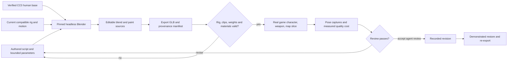

# Phase 6: Human Characters and Comic-Book Blender Iteration - Research

**Researched:** 2026-10-04
**Domain:** Blender-authored human character assets, illustrated browser rendering, reproducible iteration
**Confidence:** MEDIUM — official sources checked; actual Blender fit/export and visual acceptance remain execution probes.

<user_constraints>
## User Constraints (from CONTEXT.md)

<!-- DATA_62fb09de_START -->
### Locked Decisions
### Character design
- **D-01:** Real human proportions, with credible hands, visible face and weapon grips.
- **D-02:** Near-future soldiers wearing streamlined tactical armor: fitted plates
  over fabric and restrained futuristic details, with a helmet and visible face.

### Comic-book treatment
- **D-03:** Intensive black contour lines. Strong outer silhouette plus selected
  finer internal details on armor, seams and faces.
- **D-04:** Illustrated/painted surface treatment with soft shading, readable
  realistic forms and detail on armor, fabric and skin.
- **D-05:** Grounded muted armor/fabric colors, painted wear and bold colored accents.

### Delivery
- **D-06:** Remain a browser game. Provide scalable visual quality suitable for
  phones, integrated graphics and stronger PCs; target 60 FPS without claiming
  unmeasured device qualification.
- **D-07:** Iterate through Blender with LLM-authored operations. Actual available
  tools must be verified. A documented, bounded Python script workflow is valid;
  reproducible editable sources, exports, comparison and restoration are required.

### the agent's Discretion
The user explicitly delegates all remaining interpretation and implementation:
"do your interpretation till the end of this phase, please implement".
Choose the face, armor construction, palette details, team accent placement,
outline technique, first-person presentation and practical review cadence.
Interpret the earlier gameplay appearance "yes" as consistency between visible
first-person elements, third-person bodies and readable friendly/hostile actors.
Use actual in-game pose captures to review the slice and improve it before final
delivery. Preserve asset loading fallbacks and resource ownership. Prefer a
portable, pinned official Blender runtime if no local executable exists; no paid
service, account or machine-wide installation is implied. Select sensible
quality defaults and record measured costs. Do not substitute shader changes
alone for improving the model. Human subjective acceptance must be accurately
distinguished from automated and agent visual verification.

### Deferred Ideas (OUT OF SCOPE)
Animation overhaul and smoother transitions belong to Phase 7. Omnimovement,
terrain/camera collision fixes and final movement/animation acceptance belong to
Phase 5. Map generation/editor, attachments, loadout preview and broader netcode,
platform and Raspberry Pi qualification remain in their scheduled phases.
<!-- DATA_62fb09de_END -->
</user_constraints>

## Summary

Use a pinned portable Blender runtime to build a human soldier from a positively licensed human base, fit it to the current compatible rig, author original fitted armor and painted maps, and export editable source plus browser GLB. Retain the current gameplay animation pipeline. This is a research recommendation within delegated discretion, not a claim that the new body already passes fitting or visual review. [ASSUMED]

The current asset is visibly an orange/purple faceless mannequin: a real-browser armed-pose capture was generated and inspected during this session. Binary inspection measured 13,743 triangles, 65 joints, two flat-color material primitives and 48 animation entries; several entries have duplicate Mixamo-style names. Its mesh metadata does not establish origin or redistribution rights. [VERIFIED: session GLB parse and visual inspection, 2026-10-04] The installed rendering stack is Three 0.160.1; the existing alias, hand-mount and lifecycle contracts are suitable preservation boundaries. [VERIFIED: node_modules/three/package.json:1-4; src/builders/enemyGLTF.js:36-69,275-301,325-471]

**Primary recommendation:** Implement the asset/tooling probe first, then the human body, then selective paint/ink rendering and scalable quality, then a demonstrated edit/export/compare/revert cycle. Keep licensing resolution and subjective acceptance explicit; neither a missing local Blender executable nor unmeasured phone performance should prevent local implementation. [ASSUMED]

## Architectural Responsibility Map

This is the prescribed ownership map for the plan. [ASSUMED]

| Capability | Primary Tier | Secondary Tier | Rationale |
|---|---|---|---|
| Editable human, armor, paint and export | Offline Blender tooling | Static assets | Author geometry/textures once; never regenerate a body in the frame loop. |
| Skeleton cloning, materials, outlines, quality | Browser / Client | Static assets | Rendering and resource lifetime follow the current character owner. |
| Authoritative movement/combat/team membership | Existing API / Backend | Browser presentation | Visual changes consume current snapshots; do not create gameplay signals. |
| Source provenance and build manifest | Repository / Offline tooling | Static assets | Link source/operation/export hashes; distinguish licensed base from original additions. |
| Iteration comparison and restoration | Offline tooling and browser review | Repository history | Produce bounded changes and demonstrate recovery using real exports. |

## Project Constraints (from AGENTS.md)

These actionable constraints are carried into planning from the repository instructions opened this session. [VERIFIED: AGENTS.md, sections Project and tooling; Runtime map; Maps and editor; Character animation and weapons; Validation and deployment]

- Use the tracked lockfile and `npm ci`; Node 24; plain ES modules; follow two-space indentation, semicolons, single quotes, ES5 trailing commas and surrounding style. Keep unrelated reformatting out.
- Serve through Vite. Keep asset URLs prefix-aware through the existing base URL mechanism. Update relevant architecture context when changing architecture.
- Preserve asynchronous loading fallbacks and wait for enabled start buttons. Browser tests need Chromium; general JavaScript typecheck does not check JS bodies.
- Keep server code independent of browser singletons. Preserve room authority, intent boundaries, TLS/admission, actor generation ownership, retirement, pointer lock and offline lifecycle behavior.
- Preserve skeleton clone/mixer isolation, locomotion/override/inertia handling and load-time track preparation order: copy buffers, strip only rest-equivalent tracks, compose armed clips, normalize signs and align boundaries.
- Gameplay owns world motion. Do not add global clip-axis corrections or reintroduce per-frame upper-body grafts. Preserve hand basis and initial weapon parenting.
- Preserve shared template geometry and explicitly retire owned geometry, materials, skeleton textures, mixer bindings and helpers. Audit any additional outline or texture ownership.
- Keep frame seconds separate from weapon/AI milliseconds. Keep camera simulation eye restoration after rendering; inspect actual posed weapon alignment.
- Preserve map/ramp height, tile serialization and mode lifecycle if rendering touches map construction. Coordinate DOM/CSS/consumers for quality UI.
- Run checks appropriate to the change, including actual pose inspection; passing angle metrics or headless smoke tests do not establish visual correctness. Existing documentation is historical unless verified against source.
- Markdown does not regenerate separate HTML documentation. Do not claim broader device performance from a headless run.

<phase_requirements>
## Phase Requirements

Descriptions copied from the requirements file opened this session. [VERIFIED: .planning/REQUIREMENTS.md:51-54]

| ID | Description | Research Support |
|---|---|---|
| ART-01 | Players see accepted humanlike character proportions, silhouettes, and weapon grips in the running game, with editable sources and asset-specific provenance retained. | Licensed anatomical base, unchanged rig contract, pose review and provenance ledger. |
| ART-02 | Players see the chosen comic-book look through illustrated textures, stylized lighting, and scalable outlines on a representative character/weapon/environment slice. | Painted PBR maps, selected silhouette ink, internal texture linework, measured quality tiers. |
| ART-03 | A creator can iterate a model/material through the verified Blender automation workflow, export it reproducibly, and review the result in-game before accepting it. | Pinned portable executable, bounded script, manifest, browser comparison and regeneration. |
| ART-04 | A creator can use LLM-assisted Blender operations through a documented available integration or script workflow, with inspectable changes and a recoverable prior source version. | Checked-in authored scripts/parameters and demonstrated source/artifact rollback. |
</phase_requirements>

## Standard Stack

| Component | Pin | Purpose / decision | Provenance |
|---|---|---|---|
| Three.js | Installed `0.160.1` | Keep current runtime; use existing glTF, skeleton, materials and shader chunks. Do not upgrade for this phase. | [VERIFIED: node_modules/three/package.json:1-4] Quote: `"name": "three", "version": "0.160.1"` (adjacent properties). |
| Blender Windows x64 portable | 4.5.13 LTS | Official ZIP, offline authoring/export; pin a known checksum rather than floating latest. | [CITED: https://download.blender.org/release/Blender4.5/] |
| Built-in glTF exporter | Bundled with pinned Blender | Export GLB, skin, sampled actions and supported image textures; probe actual operator properties. | [CITED: https://docs.blender.org/manual/en/4.5/addons/import_export/scene_gltf2.html] |
| Python | Blender's bundled interpreter | Execute authored geometry/paint/export scripts; system Python is not the `bpy` runtime. | [CITED: https://docs.blender.org/manual/en/4.5/advanced/command_line/arguments.html] |
| Human base | MakeHuman official pinned asset, below | Credible face/fingers/body topology, adapted into an original soldier design. | [CITED: https://raw.githubusercontent.com/makehumancommunity/makehuman/a8bc2d54ff0ac92e78ff71431b1023eda42bf482/makehuman/data/3dobjs/base.obj] |
| Vitest / Playwright | Existing lockfile versions | Reuse unit, actual-GLB, offline and multiplayer regression infrastructure. | [VERIFIED: package.json:10-19,24-32] Quote: `"test": "vitest run"`, `"test:e2e": "playwright test"`, `"test:mp": "playwright test --config playwright.multiplayer.config.js --workers=1"`. |

**Installation:** No new npm/PyPI runtime dependency is recommended. Download and verify the portable Blender archive into an ignored owned cache or OS-temp directory; do not commit the executable archive. Its official listing gives 398,648,740 bytes and publication 2026-08-25. [CITED: https://download.blender.org/release/Blender4.5/]

**Exact acquisition:** `https://download.blender.org/release/Blender4.5/blender-4.5.13-windows-x64.zip`

**SHA256:** `b5fdf800ce65fa2f209e8f68d02667e4d720fa1c42f247c72d1882ab04decba6`. The checksum manifest was fetched successfully with PowerShell when the web tool returned HTTP 402; the archive itself was not downloaded by research. [CITED: https://download.blender.org/release/Blender4.5/blender-4.5.13.sha256]

### Alternatives Considered

| Choice | Alternative | Decision |
|---|---|---|
| CC0 MakeHuman base, original armor | Quaternius Universal Base Characters | Quaternius explicitly offers regular humans under CC0, but editable `.blend` is in the separate Source tier; do not assume the free archive includes it. Direct pinned MakeHuman OBJ and license are available without a purchase. [CITED: https://quaternius.com/packs/universalbasecharacters.html] |
| Painted soft PBR plus ink | Wholesale toon-material replacement | Toon material exists, but material type alone does not make illustrated textures or credible anatomy. Keep soft shading and author painted detail as requested. [CITED: https://threejs.org/docs/pages/MeshToonMaterial.html] [ASSUMED] |
| Existing compatible rig | New rig/animation overhaul | Keep Phase 6 bounded and protect already working mounts/animations. Body fit must pass a probe; Phase 7 owns motion improvements. [VERIFIED: 06-CONTEXT.md, Deferred Ideas quoted above] [ASSUMED] |

## Package Legitimacy Audit

No external npm/PyPI/crates packages are proposed for installation; therefore no package install legitimacy gate is needed. Portable Blender is verified against its official download/checksum manifest instead. Do not add an unofficial Blender Python package, paid model service or AI backend. [ASSUMED]

## Real Asset Inspection and Provenance

### Current GLB contract

Binary JSON and accessor inspection this session measured 3,153,956 bytes, 8,548 exported vertices across two primitives, 13,743 triangles, 65 joints and 48 animation entries. Overall rest-space height is approximately 1.829m; arm span approximately 1.944m. These are export measurements, not proof of human visual acceptance. A real-browser armed pose was rendered with the actual loader and inspected: smooth faceless head, segmented mannequin limbs, glove-like fingers, orange main shell and purple joints. [VERIFIED: session binary parse and `.planning/research/.cache/06-baseline-character.png` visual inspection]

Metadata verbatim: `"generator": "Khronos glTF Blender I/O v5.1.18"`, `"name": "Mannequin"`, skin `"name": "Armature"`, materials `"name": "M_Main"` and `"name": "M_Joints"`, both `"doubleSided": true`. No image array appeared in the parsed JSON; inspection observed base-color factors rather than painted maps. This is an observation about this binary, not a general exporter limitation. [VERIFIED: session GLB JSON read]

Preserve these exact source contracts; the quoted values make future plan examples checkable. [VERIFIED: src/builders/enemyGLTF.js:36-69,275-301,397-416; src/builders/rifleClips.js:4-6,15-23; src/builders/weapon3pTransform.js:11-26]

<!-- DATA_f93508b2_START -->
```js
const REQUIRED_KEYS = ['idle', 'walk'];
export const RIFLE_MOVEMENT_CLIPS = [
  'Crouch_Idle_Loop', 'Crouch_Fwd_Loop', 'Jump_Start', 'Jump_Loop', 'Jump_Land',
];
export const WEAPON3P_ROT = new THREE.Euler(Math.PI / 2, 0, 0);
export const WEAPON3P_GRIP = new THREE.Vector3(-0.015, 0.015, 0.025);
export const WEAPON3P_BARREL_SHIFT = { m4: -0.10, p90: -0.06, awp: -0.14, pistol: -0.03 };
```
<!-- DATA_f93508b2_END -->

The loader's exact hand names are `'hand_r'`, `'hand_l'`; its aim composition queries `'attack'` and `'spine_01'`. The head joint inspected in the actual binary is `'Head'`. Preserve names, parent transforms, bind inverses, joint ordering and compatible local rest axes, not merely a list of bone labels. Keep the existing clip pipeline and do not prune inherited duplicates in this phase unless separately validated. [VERIFIED: src/builders/enemyGLTF.js:397-405; src/builders/rifleClips.js:15-23; session GLB skin read] [ASSUMED]

### Positive licensed source

Use MakeHuman repository commit `a8bc2d54ff0ac92e78ff71431b1023eda42bf482`. The official raw `makehuman/data/3dobjs/base.obj` was opened directly in this session; its header explicitly assigns CC0 and names Data Collection AB, Joel Palmius and Jonas Hauquier as 2020 copyright holders. Retain the downloaded bytes, original header, source URL, commit and hash plus `LICENSE.md` and `LICENSE.ASSETS.md`. [CITED: https://raw.githubusercontent.com/makehumancommunity/makehuman/a8bc2d54ff0ac92e78ff71431b1023eda42bf482/makehuman/data/3dobjs/base.obj] [CITED: https://raw.githubusercontent.com/makehumancommunity/makehuman/a8bc2d54ff0ac92e78ff71431b1023eda42bf482/LICENSE.md]

Raw asset inspection counted 19,158 vertices, 18,486 polygons and 13,378 polygons in group `body`; other groups include joint landmarks and helper shapes. Import only body render faces and required intentional eye geometry, not helper tights/hair/genital/joint volumes. Use helper centers for source fitting landmarks before dropping them. The untouched base may exceed the current triangle count after triangulation; generate a reviewed game mesh rather than assuming the source is mobile-ready. [CITED: pinned base.obj above] [ASSUMED]

MakeHuman's current official license separates CC0 bundled graphical assets from AGPL program logic, and warns that third-party community assets can have other licenses. Downloading the verified base alone does not require shipping MakeHuman's Python application. Do not copy MakeHuman code into the browser or assume an unrelated skin/clothing download has CC0 terms. [CITED: https://raw.githubusercontent.com/makehumancommunity/makehuman/a8bc2d54ff0ac92e78ff71431b1023eda42bf482/LICENSE.md]

### Inherited source risks and disposition

- **Existing body/rig/mannequin-family motion:** comments say Quaternius-style and tools documentation says UE-mannequin; these labels are not asset-specific source evidence. Research found no affirmative license in the examined asset/tool documentation. Record origin/license as unresolved, and do not relabel the inherited rig or clips as original/CC0. Source-history or original-download evidence is required to close that gap. [VERIFIED: src/builders/enemyGLTF.js:7-10,414-416; tools/README.md:6-11,45-48] [ASSUMED]
- **Mixamo motion:** Adobe's FAQ affirmatively permits royalty-free use in games. It does not establish that the specific repository FBX files may be published as a standalone open animation library. Keep game-use evidence separate from raw-source redistribution clearance. Existing retargeted clips can remain the local compatibility input, with unresolved raw redistribution explicitly recorded; do not expand redistribution during this phase. [CITED: https://helpx.adobe.com/creative-cloud/faq/mixamo-faq.html] [ASSUMED]
- **Existing weapon FBX:** executable loading is not provenance. Representative new paint should use the repository procedural weapon geometry or a separately documented original Blender source, rather than claiming the inherited FBX is original. Current default first-person FBX loader chooses P90; keeping that loader behavior is distinct from changing weapon geometry. [VERIFIED: src/builders/weaponFBX.js:28-29] Quote: `export async function tryLoadWeaponFBX(path = import.meta.env.BASE_URL + 'models/FBX/P90.fbx')`. [ASSUMED]
- **Original additions:** record armor meshes, helmet, illustrated maps and scripts as newly authored contributions. A derived combined GLB remains mixed provenance when it embeds inherited rig/motion. Do not make an unsupported whole-asset license claim. [ASSUMED]

Licensing provenance is a delivery limitation that must remain visible if historical records cannot be recovered. It is not a technical inability to author/export a locally reviewable model. Do not claim ART-01 provenance is fully cleared while inherited inputs remain unresolved. [ASSUMED]

## Architecture Patterns

### Data flow



This diagram describes the recommended implementation workflow. [ASSUMED]

### Human construction and fitting

1. Probe import/export of the unchanged rig under pinned Blender before replacing the production binary. Inspect actual exporter RNA options rather than assuming another Blender version's API. Save a baseline source and semantic manifest. [ASSUMED]
2. Import the licensed human body; remove helpers from render output; fit height, shoulder/hip/head and limb landmarks to the existing rig in world space. Keep original facial planes and fingers, and use corrective mesh edits rather than a stack of primitive spheres for the face. [ASSUMED]
3. Rebind the body to compatible bones. Use Blender skinning/data transfer as an initial result and validate weights, joint influence limits, fingers, armpits, wrists, crotch and knees in actual armed/crouched/jumping poses. Source/target rest pose differences are a real execution risk; nearest-point weight transfer alone is not acceptance. [CITED: https://docs.blender.org/manual/en/4.5/addons/import_export/scene_gltf2.html] [ASSUMED]
4. Build fitted segmented plates around the human torso, forearms/shins and shoulders; leave flexible joint gaps. Use a helmet with open facial area, readable brow/nose/lips/eyes and restrained technical details. Create separate material domains for skin, fabric, armor, team accents and ink. [ASSUMED]
5. Consolidate static armor parts into a small number of skinned/material batches; weight rigid plates to the appropriate bone region, and soft suit/hands smoothly. Preserve grip contact through model fitting, not by moving the gameplay weapon basis blindly. [ASSUMED]

### Painted soft shading with controlled contours

Keep supported Principled/image-texture material nodes for glTF and soft browser PBR shading. Author or bake base-color illustration: warm/cool skin planes, seam ink, sparse cloth weave, edge wear, armor brush strokes and carefully placed colored team panels. Use UV-aware body maps; skin should not inherit repeating armor stripes or noisy crack textures. Blender arbitrary shader graphs do not automatically become identical browser shaders. [CITED: https://docs.blender.org/manual/en/4.5/addons/import_export/scene_gltf2.html] [ASSUMED]

Use the official r160 OutlineEffect technique for strong silhouettes: its vertex source includes skinning/morph chunks and projected-normal thickness. Use internal painted lines for facial features and armor seams. Scope outline eligibility to selected opaque body/weapon/environment surfaces; avoid dense outlines on every decorative mesh, particles, debug helpers and HUD. [CITED: https://raw.githubusercontent.com/mrdoob/three.js/r160/examples/jsm/effects/OutlineEffect.js] [ASSUMED]

**Required lifecycle adaptation:** the opened r160 effect source's cache eviction deletes entries without disposing the generated shader material and exposes no effect disposal method. Do not adopt it verbatim as a resource owner. Preserve its MIT attribution and add explicit disposal of cached materials on expiry/retirement/effect shutdown, or implement owned skinned hull materials using its proven shader chunks. The latter requires sharing the actor's skeleton, not cloning a second independent animated rig. Use one approach, with a repeat-retirement program/memory test. [CITED: https://raw.githubusercontent.com/mrdoob/three.js/r160/examples/jsm/effects/OutlineEffect.js] [ASSUMED]

Current tint clones and recolors every mesh material, including owned materials; it will tint skin, ink and weapon parts unless narrowed. Introduce semantic eligibility and tint only designated team accents. Preserve array material groups and restore from immutable base colors on reassignment. Share base textures across actors; disposing a tint clone must not dispose shared textures. [VERIFIED: src/builders/enemyGLTF.js:477-509; src/builders/characterResources.js:20-30] [ASSUMED]

### Component Responsibilities

Existing integration seams, not claims that proposed new files already exist. [VERIFIED: source files opened this session] Proposed paths below are [ASSUMED].

| Seam | Responsibility |
|---|---|
| Existing character loader/builders | Load asset, prepare clips, style template/instances, clone rig, attach weapons, preserve fallback. |
| Existing character resource owner | Dispose new instance materials/ink resources while preserving template geometry and shared maps. |
| Existing frame render seam | Quality-aware ink pass before restoring simulation camera; no gameplay changes. |
| Existing materials/lighting/map extras | Representative existing-map paint and lighting; leave collision/topology unchanged. |
| Existing remote actor adapter | Consume team/generation snapshots; no new authority decisions. |
| Proposed `tools/art/` | Download manifest, source parameters, Blender build/export/iteration scripts and asset inspection. |
| Proposed `tools/art/sources/` | Editable source, CC0 base license/citation, authored maps and provenance ledger. |
| Proposed phase evidence directory | Before/after pose sheets, iteration/restore outputs and measured renderer costs. |

### Quality scaling

Provide explicit Low/Medium/High visual settings with persisted local preference and a visible selectable control. Suggested initial policy: Low caps pixel ratio around 1 and disables expensive shadow/extra ink work; Medium caps around 1.5 with actor/weapon silhouettes and restrained shadows; High caps at existing 2 with additional representative environment ink. Keep internal painted linework at all tiers so Low remains recognizable. These are delegated starting values, not performance promises. [ASSUMED]

Measure warm-up and sample windows in the actual browser, record renderer, viewport, DPR, actor count, calls/triangles/programs/memory and median/p95 frame time. Report headless software-renderer measurements as software-renderer evidence. Only tested real phone/integrated/PC hardware earns device-class qualification; 60 FPS is a target. [VERIFIED: 06-CONTEXT.md, D-06 quoted above] [ASSUMED]

## Don't Hand-Roll

| Problem | Do not build | Use instead | Source |
|---|---|---|---|
| glTF container/export | Custom binary exporter | Blender bundled exporter and existing loader | [CITED: Blender glTF manual above] |
| Anatomically credible face/hands | Primitive sphere/cylinder mannequin replacement | Verified anatomical base plus edited topology | [CITED: pinned MakeHuman mesh above] [ASSUMED] |
| Clone animated actor | Independent ad-hoc bone copying | Existing SkeletonUtils clone and per-actor mixer | [VERIFIED: src/builders/enemyGLTF.js:13-15,336-349] |
| Runtime geometry AI | New model service/backend | Authored bounded offline Blender script | [VERIFIED: 06-CONTEXT.md, D-07 and Discretion quoted above] |
| Raw shader invention | Unverified screen-space skinning math | r160 official outline technique with explicit ownership adaptation | [CITED: official r160 OutlineEffect source above] |

## Runtime State Inventory

This is an asset replacement/migration inventory; no gameplay identity rename is prescribed. Unknown external state is not reported as verified absence. [ASSUMED]

| Category | Items / evidence | Action |
|---|---|---|
| Stored data | No inspected character code persists body geometry. New quality preference would create local browser state. [VERIFIED: inspected character/remote/resource source] [ASSUMED] | Define bounded versioned preference; no database migration is proposed. |
| Live service config | Existing authoritative actor snapshots drive cosmetic poses/teams. [VERIFIED: src/network/remoteActors.js:26-68,111-174] | Keep server protocol/rules untouched; re-run multiplayer lifecycle coverage. |
| OS-registered state | No new registration needed for portable Blender; external OS inventory was not performed. [ASSUMED] | Extract/run by absolute path; do not register file associations or install machine-wide. |
| Secrets/env vars | No secret is needed for CC0 raw download, official portable Blender or authored local scripts. [ASSUMED] | Do not add API keys, paid accounts or service credentials. |
| Build artifacts | Vite production output and browser GLB are compiled delivery products; existing runtime uses `models/enemy.glb`. [VERIFIED: src/builders/enemyGLTF.js:279,287] Quote: `'models/enemy.glb'`. | Regenerate build and export; compare source/artifact hashes and invalidate stale cached review assets. |

## Common Pitfalls

- **Shader-only improvement:** the measured old body has no visible human face. Passing material tests on the mannequin cannot satisfy ART-01. Review human face, silhouette and gloves at playable distances. [VERIFIED: inspected baseline capture] [ASSUMED]
- **Wrong source/rest space:** current root-axis history and weapon hand basis are deliberate. Preserve them; fit a body to the rig before exporting rather than changing clip quaternions globally. [VERIFIED: src/builders/weapon3pTransform.js:3-17; src/builders/enemyGLTF.js:79-90] [ASSUMED]
- **Plate/finger clipping:** automatic skinning needs posed review. Sample idle, crouch, directional movement, jump phases, reload, throw, melee and death; inspect hand contact and plate joint gaps. Do not turn this into the Phase 7 animation overhaul. [ASSUMED]
- **Double bake:** painted soft light plus very strong runtime light can wash out skin/armor. Bake illustration/occlusion rather than the full directional lighting twice, and tune exposure against actual scenes. [ASSUMED]
- **Texture ownership:** current disposal collects owned/tinted materials and skeletons, but does not own/dispose shared map textures. Adding per-instance canvas maps without a new owner leaks; disposing shared maps breaks live siblings. [VERIFIED: src/builders/characterResources.js:20-30] [ASSUMED]
- **Ink overdraw and seams:** inflated backfaces can expose seams on split/hard-normal meshes. Inspect face silhouette, fingers, armor pieces and far distance shimmer; lower detail eligibility at lower settings. [ASSUMED]
- **False reproducibility:** binary hashes can change from serializer metadata. Require repeatable semantic output plus recorded source/export hashes; only promise byte-for-byte identity after measuring it. [ASSUMED]
- **False acceptance:** agent visual review and automatic regression passes are evidence, not a human's subjective acceptance. State remaining acceptance honestly. [VERIFIED: 06-CONTEXT.md, Discretion quoted above]

## Code Examples

### Headless execution

Recommended PowerShell invocation; paths are proposed parameters, not existing repository paths. Flags are from the official CLI; Python exceptions must fail the process. [CITED: https://docs.blender.org/manual/en/4.5/advanced/command_line/arguments.html] [ASSUMED]

```powershell
& $blenderExe --background --factory-startup --disable-autoexec `
  --python-exit-code 1 --python $authoredScript -- `
  --source $sourceFile --out $candidateFile --params $parameterFile
if ($LASTEXITCODE -ne 0) { throw 'Blender export failed' }
```

### Existing exporter contract to probe and retain

This is verbatim from the exporter script opened this session. Add source save, explicit extras/material/image export and allowlisted outputs only after checking pinned runtime operator support. [VERIFIED: tools/retarget.py:201-205]

<!-- DATA_81cf6a40_START -->
```python
bpy.ops.export_scene.gltf(
    filepath=out, export_format='GLB',
    export_animations=True, export_animation_mode='ACTIONS',
    export_force_sampling=True, export_apply=False,
)
```
<!-- DATA_81cf6a40_END -->

### Iteration/revert acceptance procedure

Save editable baseline and manifest; run a bounded authored parameter edit (e.g. helmet cheek-guard shape or armor paint accent), export to a candidate location, load the candidate in the real game and capture matched pose/view/quality, then restore the prior source revision and regenerate its prior appearance. Keep operations inspectable and source/output backups separate; demonstrating only `git checkout` of a binary is insufficient for editable-source restoration. [ASSUMED]

## State of the Art

| Historical behavior | Required phase behavior | Impact / provenance |
|---|---|---|
| Faceless two-color mannequin | Human face/proportions with fitted armor, painted detail and visible contours | Actual visual improvement; baseline inspected this session. [VERIFIED: baseline capture] [ASSUMED] |
| Local Blender path assumed | Pinned official portable runtime, checksum and import/export probe | Reproducible available automation. [CITED: official Blender download/CLI sources above] |
| Whole-body emissive team recolor | Semantic team accent-only tint | Preserves skin, fabric, weapon and black ink. [VERIFIED: src/builders/enemyGLTF.js:485-509] [ASSUMED] |

## Environment Availability

| Dependency | Observation | Fallback / next action |
|---|---|---|
| Node / npm | `v24.19.0` / `11.17.0` from actual commands. [VERIFIED: session environment probe] | Use installed runtime. |
| System Python | `Python 3.14.7`. [VERIFIED: session environment probe] | Use only inspection; Blender supplies `bpy` interpreter. |
| Blender | PATH probe found no executable; parent reports standard-path checks also found none. [VERIFIED: session Get-Command probe] | Download verified portable 4.5.13 ZIP; verify hash, extract owned path, run version and operator probe. |
| Blender connector | No tool exposed in available-tool metadata. [VERIFIED: session tool inventory] | Authored Python CLI workflow. |
| Context7 / ctx7 | No tool and no command found in current session. [VERIFIED: session tool/PATH inventory] | Official web/source documentation fetched directly. |
| Chromium / Vite | Real character capture successfully rendered using existing Playwright Chromium and Vite 8.0.8 on owned inspection port. [VERIFIED: session browser capture] | Existing tests; shut down owned inspection server. |

**Missing dependency with practical fallback:** Blender executable, solved by pinned portable acquisition. **Unproven compatibility:** new body fitting and pinned exporter roundtrip; plan an early probe and correction task, not a claim of failure based on absent metadata. [ASSUMED]

## Validation Architecture

Validation is enabled: config declares `"nyquist_validation": true`. [VERIFIED: .planning/config.json, workflow section]

### Test Framework

| Property | Value / evidence |
|---|---|
| Framework | Existing Vitest and Playwright; package declares `"vitest": "^4.1.3"`, `"@playwright/test": "^1.40.0"`; installed pins remain lockfile-owned. [VERIFIED: package.json:24-32] |
| Configuration | Unit include quote: `include: ['src/**/*.test.js', 'server/**/*.test.js']`. Browser config quote: `testDir: './tests'`, `args: ['--use-gl=swiftshader']`. [VERIFIED: vitest.config.js:3-6; playwright.config.js:3-17] |
| Quick command | Existing focused asset/appearance unit tests plus semantic asset inspector; choose new test filename during execution. [ASSUMED] |
| Asset browser command | `npx playwright test tests/assets.spec.js tests/animation-regressions.spec.js --workers=1` (known files; runtime may exceed 30s). [VERIFIED: opened test files] |
| Full regressions | `npm run lint`, `npm run typecheck`, `npm run typecheck:mp`, `npm test`, `npm run build`, `npm run test:e2e`, `npm run test:mp`. [VERIFIED: package.json:8-19] |

### Phase Requirements → Test Map

The existing asset and animation tests already cover alias resolution, redundant-track safety, actual rig mount orientation and geometry retirement. Quote test titles: `'enemy.glb loads and every gameplay clip resolves'`, `'player and enemy weapons follow the armed poses with the barrel forward and scope upright'`, `'repeated character removal frees instance GPU allocations and preserves live shared geometry'`. [VERIFIED: tests/assets.spec.js:6-23; tests/animation-regressions.spec.js:69-132]

Proposed phase tests/commands below are execution work, not existing tests. [ASSUMED]

| Req | Behavior | Test type | Proposed fast command / evidence | Exists? |
|---|---|---|---|---|
| ART-01 | Skin/joint/clip invariants, weights, anatomical source/provenance | Semantic asset + browser + visual | `node tools/art/inspect-character.mjs`; existing actual-rig browser suite; matched human face/grip pose captures | Inspector/new visual rubric: Wave 0 |
| ART-02 | Accent-only tint, valid painted maps, skin/ink preservation, quality settings and cleanup | Unit/browser/performance | `npx vitest run src/builders/characterAppearance.test.js`; focused browser tier/retirement smoke; measured costs | New tests: Wave 0 |
| ART-03 | Pinned export and comparison, semantic reproducibility | Offline integration/browser | `node tools/art/verify-export.mjs`; invoke pinned Blender twice then compare manifests | New tooling: Wave 0 |
| ART-04 | Bounded authored edit and full source restoration | Offline integration/visual | Scripted edit/restore manifest check plus matched before/changed/restored pose sheet | New tooling: Wave 0 |

Human subjective acceptance is manual-only because human proportions, illustration quality and aesthetic approval cannot be proved by a numeric assertion. Agent visual review should improve the asset before presentation but must not be reported as a human acceptance event. [VERIFIED: 06-CONTEXT.md, Discretion quoted above] [ASSUMED]

### Sampling Rate and Wave 0 Gaps

- Per task: relevant small unit/semantic test; avoid full Blender re-export for a UI-only edit. [ASSUMED]
- Per asset/export change: invariant inspector plus actual-GLB/mount and pose captures. [ASSUMED]
- Per render/resource wave: repeated team switch, death/respawn/rematch/leave and keeper geometry/texture tests; inspect renderer program count as well as memory. [ASSUMED]
- Phase gate: full available offline/multiplayer suite, production build, actual running-game review and demonstrated iteration/restore; unresolved subjective/license/device qualification is recorded separately. [ASSUMED]
- Wave 0: portable runtime acquisition/probe, pinned source/license manifest, semantic inspector, appearance/tint ownership tests, quality/pose review harness and repeat-export/restore checks. Proposed file paths above are not yet created. [ASSUMED]

## Security Domain

Config enables security enforcement. Use **ASVS 5.0 numbering**, not the older template's V2 authentication/V3 session/V6 crypto labels: official v5 source names V2 Validation and Business Logic, V5 File Handling, V6 Authentication, V7 Session Management, V8 Authorization, V11 Cryptography and V12 Secure Communication. [VERIFIED: .planning/config.json, security_enforcement setting] [CITED: https://github.com/OWASP/ASVS/tree/v5.0.0/5.0/en]

| Category | Applicability / planned control |
|---|---|
| V2 Validation | Validate bounded parameter JSON, allowed operations, counts/ranges and outputs; never execute model-generated strings from runtime input. [CITED: https://raw.githubusercontent.com/OWASP/ASVS/v5.0.0/5.0/en/0x11-V2-Validation-and-Business-Logic.md] [ASSUMED] |
| V5 File Handling | Allowlist source/cache/output roots, verify ZIP SHA256 and extraction bounds, reject path escape and retain prior source. [CITED: https://raw.githubusercontent.com/OWASP/ASVS/v5.0.0/5.0/en/0x14-V5-File-Handling.md] [ASSUMED] |
| V6/V7/V8 | No new authentication/session/authorization feature; preserve existing server-owned membership and authority. [VERIFIED: 06-CONTEXT.md, code context] [ASSUMED] |
| V11/V12 | Standard SHA256 verification and HTTPS official downloads; do not implement custom cryptography or weaken existing TLS. [ASSUMED] |
| V13/V15 | Run reviewed authored scripts with factory startup/autoexec disabled; no untrusted `.blend` embedded scripts, no arbitrary prompt subprocess/network operations. [CITED: Blender CLI documentation above] [ASSUMED] |

| Threat | STRIDE | Mitigation |
|---|---|---|
| Asset/runtime substitution | Tampering | Pinned URL/hash, source license/header and export manifest. [ASSUMED] |
| Script/path escape | Elevation/Tampering | Reviewed bounded script, canonical allowlisted paths, candidate output first. [ASSUMED] |
| Heavy generated meshes/textures | Denial of service | Bound geometry/image sizes, quality caps and measured actor cost. [ASSUMED] |
| Client art edits influence hits | Tampering | Leave server numeric movement/combat authority unchanged. [VERIFIED: 06-CONTEXT.md, preserve multiplayer constraint] [ASSUMED] |

## Assumptions Log

All proposed implementation policies are explicitly tagged `[ASSUMED]`. The user delegated implementation choices; verify these with early execution probes and recorded review rather than adding a redundant permission checkpoint. [VERIFIED: 06-CONTEXT.md, Discretion quoted above]

| ID | Assumption / recommended decision | Risk / required verification |
|---|---|---|
| A1 | CC0 base can be fitted/skinned onto preserved rig with credible visible face/hands. | Highest technical risk; first import/fit/armed-pose/export probe before full armor production. |
| A2 | Original fitted armor and maps achieve intended illustrated soldier look. | Pose sheets and actual running-game review; no subjective acceptance claim. |
| A3 | Owned outline adaptation is sufficient and affordable. | Skinning/morph/ink tests and repeated retirement program plateau; measured quality costs. |
| A4 | Suggested quality caps/defaults work for review hardware. | Tune from measured evidence; no unmeasured phone/iGPU qualification. |
| A5 | Existing rig/motion may be used as local compatibility input while origin is investigated. | Keep unresolved origin explicit; fully cleared redistribution cannot be asserted. |
| A6 | Semantic export reproducibility and source restore are enough unless exact binary identity is measured. | Repeat export comparison and demonstrated restoration. |
| A7 | Proposed directories/tests/manifests/commands and runtime state policy fit repository conventions. | Executor creates and runs them; do not treat proposed paths as current source truth. |
| A8 | No new services, secrets, database migrations or machine registration are required. | Bound work to local authoring and existing presentation boundaries. |
| A9 | Painted PBR/internal ink plus selected hull outlines meets soft illustrated treatment. | Matched in-game light/quality comparisons; revise maps/lighting if needed. |

## Open Questions and Blocker Distinctions

1. **Inherited rig and mannequin clip provenance:** unresolved; examine history/original downloadable pack evidence. Do not assign a license by name. Blocks a claim of fully cleared asset provenance, not local implementation or testing. [ASSUMED]
2. **Actual base fit and Blender roundtrip:** not executed by this research agent (ownership is research only). Must be an early execution task with corrective iterations. A failed specific export/property/fit probe is actionable evidence, not a reason to stop at missing binary. [ASSUMED]
3. **Human aesthetic acceptance:** delegated agent review is authorized; still label final human acceptance accurately. [VERIFIED: 06-CONTEXT.md, Discretion quoted above]
4. **Device-class performance:** only review hardware/browser measurements available during execution can be asserted; broader qualification remains outside this phase. [VERIFIED: .planning/ROADMAP.md, Phase 6 research/discussion focus]

## Sources

Primary authoritative sources used:

- Official Blender release archive/checksum: https://download.blender.org/release/Blender4.5/ and https://download.blender.org/release/Blender4.5/blender-4.5.13.sha256 — pinned binary details; fetched direct when web retrieval failed.
- Blender 4.5 glTF manual: https://docs.blender.org/manual/en/4.5/addons/import_export/scene_gltf2.html — sampled actions, skinning/material/image export; direct page reports last update 2026-10-03.
- Blender CLI manual: https://docs.blender.org/manual/en/4.5/advanced/command_line/arguments.html — background, factory startup, autoexec and Python exit flags.
- Three r160 official source: https://raw.githubusercontent.com/mrdoob/three.js/r160/examples/jsm/effects/OutlineEffect.js — skinning, projected outline and cleanup; compared with installed source.
- Three r160 standard material and skeleton source: https://raw.githubusercontent.com/mrdoob/three.js/r160/src/materials/MeshStandardMaterial.js and https://raw.githubusercontent.com/mrdoob/three.js/r160/examples/jsm/utils/SkeletonUtils.js — supported painted-map/shading/cloning foundations.
- Pinned MakeHuman mesh/license URLs in source section — actual asset-specific CC0, bundled asset versus code distinction.
- Quaternius creator page: https://quaternius.com/packs/universalbasecharacters.html — licensed alternate human body and source-tier distinction; no archive downloaded.
- Adobe official Mixamo FAQ: https://helpx.adobe.com/creative-cloud/faq/mixamo-faq.html — affirmative game-use permission, last updated 2021-09-14; no raw-library clearance asserted.
- OWASP official ASVS v5.0.0 source tree and V2/V5 pages above — correct security categories.
- Source files and actual GLB/browser capture cited inline — current repository contracts and physical asset inspection.

## Metadata

**Confidence:** Standard stack MEDIUM (official sources, portable archive not executed); architecture HIGH for opened current ownership contracts, MEDIUM for proposed fit/render pipeline; pitfalls HIGH for measured current tint/resource behavior, MEDIUM for proposed asset work. No claim that body fitting or phone performance is already verified.

**Research seam:** question plan emitted Context7 for Blender/Three and websearch for licensing. Context7/ctx7 unavailable, so official documentation/source fallback was used; classify-confidence `--provider websearch --verified` returned `MEDIUM`. Digests cached through the research-store seam. Graph status reported disabled. Configured agent skill mapping is empty; no project skill directories were discovered. [VERIFIED: session research/init/config/tool probes]

**Validity:** Recheck binary/checksum only if deliberately changing the pin; inspect source contracts after concurrent edits. Recheck external licenses before redistribution. Proposed performance/visual quality decisions remain execution-reviewed. [ASSUMED]
